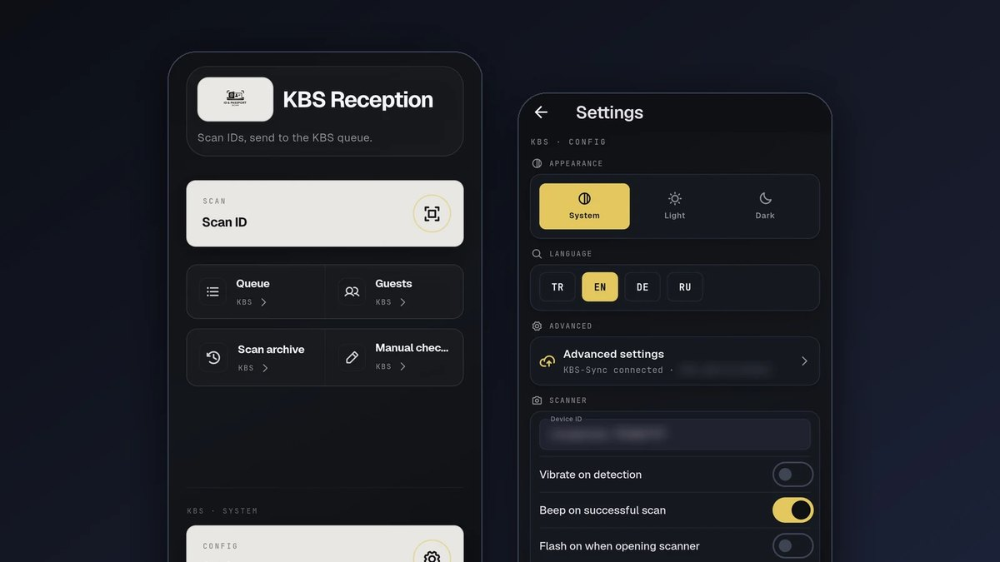
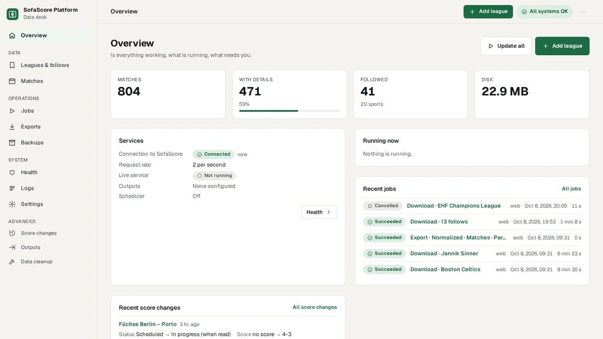
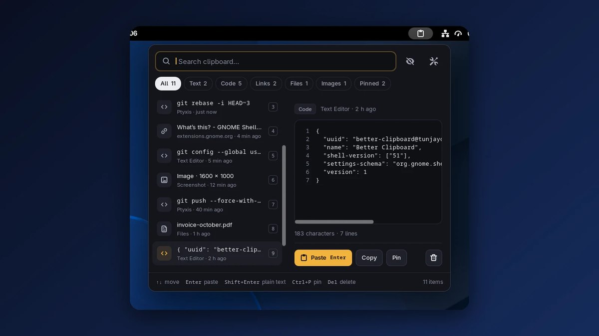
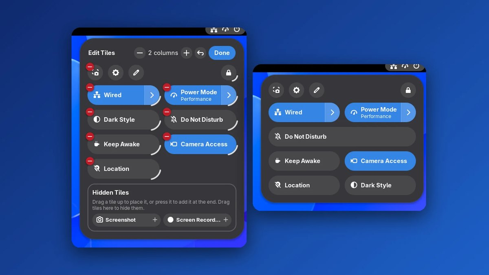

# Tuncay Eşsiz

I build local-first automation, Linux desktop tools and data platforms. Most of them started from something I needed myself: identity reporting at a hotel front desk, the GNOME desktop I use every day, match data.

MIS graduate, Bakırçay University (2026) · İzmir, Turkey

[tuncayessiz.dev](https://tuncayessiz.dev) · [LinkedIn](https://www.linkedin.com/in/tuncayessiz/) · tuncay.essiz@outlook.com

## Featured

### [KBS-Sync](https://github.com/tunjayoff/KBS-Sync)

Hotel identity reporting on the local network, with no required cloud service: an Android MRZ scanner, a Go agent on the reception PC and a Chrome extension.

Go, Dart, Android, Chrome extension

### [SofaScore Scraper](https://github.com/tunjayoff/sofascore_scraper)

Self-hosted data platform for SofaScore match data in 21 sports. One core, used as a Python library, the `ssc` command line, or an HTTP API with a web app.

Python, SQLite, Docker

### [Better Clipboard](https://github.com/tunjayoff/gnome-better-clipboard)

Keyboard-first clipboard history for GNOME Shell. Opens at the pointer with Super+V, previews code, links, files and images, and keeps passwords out of history.

GNOME Shell, JavaScript (GJS)

### [Quick Tiles](https://github.com/tunjayoff/gnome-quick-tiles)

Edit the GNOME Quick Settings menu from inside the menu: drag to reorder, resize, hide and add tiles, plus custom tiles that run shell commands.

GNOME Shell, JavaScript (GJS)

## More projects

- **[appimagemanager](https://github.com/tunjayoff/appimagemanager)** — Install, manage, and remove AppImages on Ubuntu.
- **[md_to_rag](https://github.com/tunjayoff/md_to_rag)** — Markdown to RAG-ready vectors (chunk, embed, Qdrant).
- **[PlayerAnalysis](https://github.com/tunjayoff/PlayerAnalysis)** — Süper Lig player clustering and position models in R.
- **[ventigescaffee](https://github.com/tunjayoff/ventigescaffee)** — Café landing page ([live](https://ventigescaffee.vercel.app)).

Write-ups with screenshots for each project are on [tuncayessiz.dev/en/projects](https://tuncayessiz.dev/en/projects).

## Stack

Python · TypeScript · JavaScript (GJS) · Go · Dart · R · SQL · Linux
